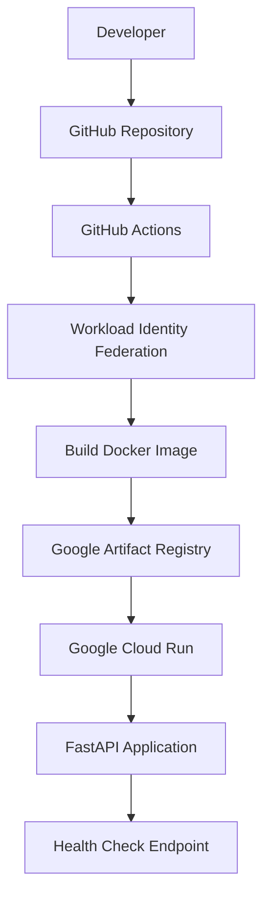

# GCP DevOps Project — Terraform, Docker, FastAPI & CI/CD

A hands-on DevOps project that deploys a containerized FastAPI application to Google Cloud Run using Terraform, Docker, Google Artifact Registry, and GitHub Actions.

## 🚀 Live Demo

- **Application:** https://gcp-fastapi-demo-lw4q3iluvq-el.a.run.app/
- **Health Check:** https://gcp-fastapi-demo-lw4q3iluvq-el.a.run.app/health
- **API Documentation:** https://gcp-fastapi-demo-lw4q3iluvq-el.a.run.app/docs
- **GitHub Repository:** https://github.com/1225ayaan/terraform-docker-gcp

## 📌 Project Overview

This project demonstrates how to containerize a Python API, provision cloud infrastructure with Infrastructure as Code (IaC), and automate application deployment through a CI/CD pipeline.

The deployment uses Google Cloud Run to run the containerized application and Google Artifact Registry to store Docker images. GitHub Actions automates the build, push, and deployment process whenever code is pushed to the `main` branch.

## 🏗️ Architecture



## 🛠️ Technologies Used

| Technology | Purpose |
|---|---|
| Google Cloud Platform | Cloud infrastructure and hosting |
| Cloud Run | Managed container deployment |
| Artifact Registry | Docker image storage |
| Terraform | Infrastructure as Code |
| Docker | Application containerization |
| Python | Application programming language |
| FastAPI | REST API framework |
| Git and GitHub | Version control and source repository |
| GitHub Actions | Automated CI/CD |
| Workload Identity Federation | Keyless GitHub-to-GCP authentication |

## 🔄 CI/CD Pipeline

The GitHub Actions workflow is defined in `.github/workflows/deploy.yml`.

On every push to `main`, the pipeline:

1. Checks out the source code.
2. Authenticates to Google Cloud using Workload Identity Federation.
3. Configures Docker authentication for Artifact Registry.
4. Builds the Docker image from the application Dockerfile.
5. Pushes the image to Google Artifact Registry using the commit SHA as its tag.
6. Deploys the image to Google Cloud Run.

The workflow also supports manual execution through `workflow_dispatch`.

## ☁️ Infrastructure as Code

The Terraform configuration is maintained in `main.tf`.

It defines and manages:

- A Google Artifact Registry Docker repository.
- A Google Cloud Run service.
- IAM access for invoking the public demo API.
- Cloud Run scaling configuration with a minimum of zero and a maximum of one instance.

Terraform's `lifecycle.ignore_changes` configuration prevents Terraform from overwriting the application image version and deployment metadata managed by the deployment workflow.

## 🧪 Application Endpoints

| Endpoint | Description |
|---|---|
| `/` | Returns the application welcome message and status |
| `/health` | Returns the application health status |
| `/docs` | Opens interactive FastAPI documentation |

Example health check response:

```json
{
  "status": "healthy"
}
```

## 💻 Run Locally

### Prerequisites

- Python 3.12 or compatible environment
- Docker Desktop
- Git

### Build the Docker image

Run from the repository root:

```powershell
docker build -t gcp-fastapi-demo:1.0 ./app
```

### Start the container

```powershell
docker run --rm -p 8081:8080 gcp-fastapi-demo:1.0
```

### Test the application

Open these URLs in your browser:

- http://localhost:8081/
- http://localhost:8081/health
- http://localhost:8081/docs

## 📁 Repository Structure

```text
terraform-docker-gcp/
├── .github/
│   └── workflows/
│       └── deploy.yml
├── app/
│   ├── Dockerfile
│   ├── main.py
│   └── requirements.txt
├── .gitignore
├── main.tf
└── README.md
```

## 🔐 Security Considerations

- Uses Workload Identity Federation instead of a long-lived service-account JSON key.
- Restricts the GitHub identity provider to the intended repository.
- Keeps credentials, secrets, Terraform state files, and local environment files out of source control.
- The demo API is publicly accessible; production deployments should use appropriate authentication and access controls.

## 💰 Cost Awareness

Cloud Run may scale down to zero instances when idle, but this does not guarantee that the project is entirely free. Artifact Registry storage, network usage, and other resources may incur charges.

Monitor Google Cloud Billing regularly and remove resources that are no longer required.

## 🔮 Future Improvements

- Add automated unit and API tests.
- Add Docker image vulnerability scanning.
- Integrate Terraform formatting and validation into CI.
- Improve deployment monitoring and rollback procedures.
- Add structured logging and alerting.

## ✅ Project Status

The initial deployment has been tested successfully. The application and health-check endpoints return the expected responses, GitHub Actions CI/CD has completed successfully, and Terraform reports that the infrastructure matches its configuration.